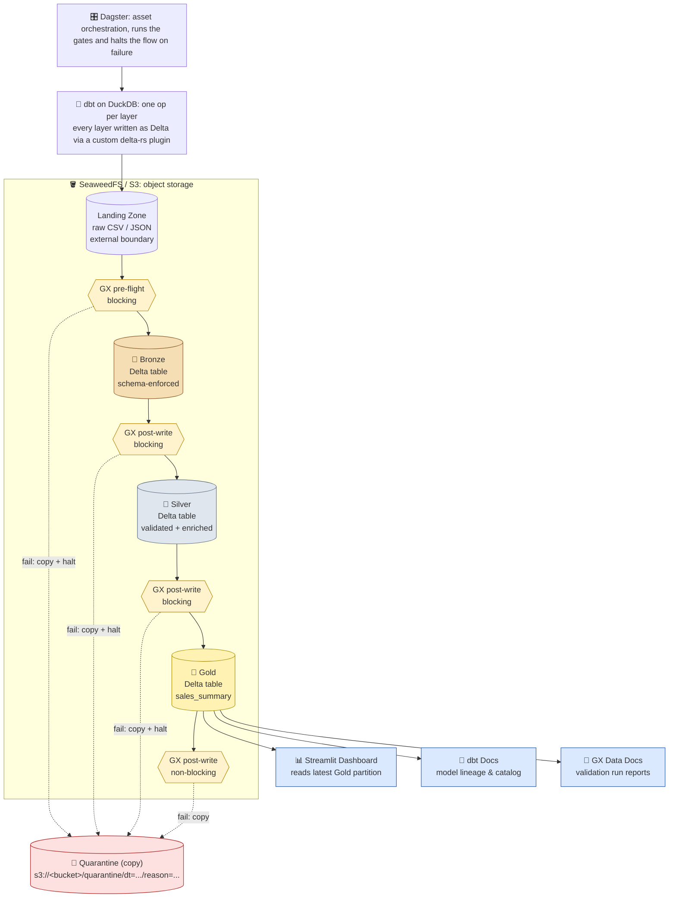
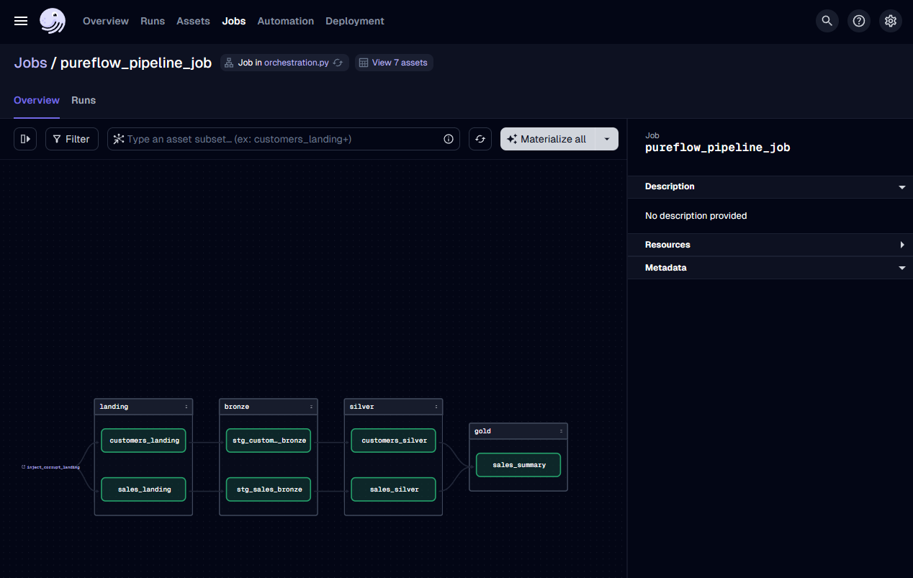
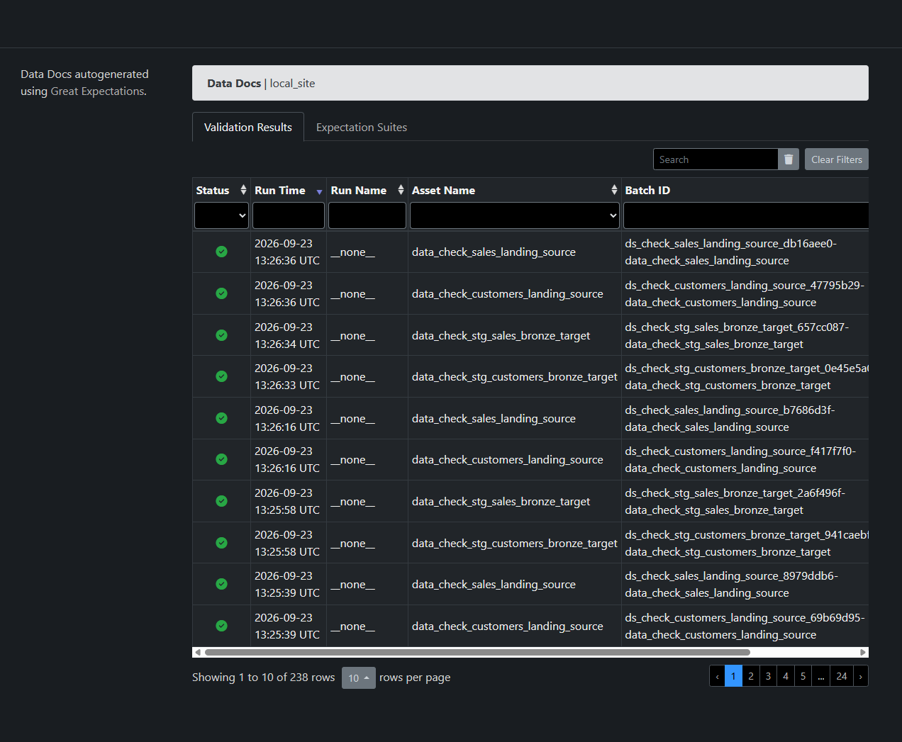
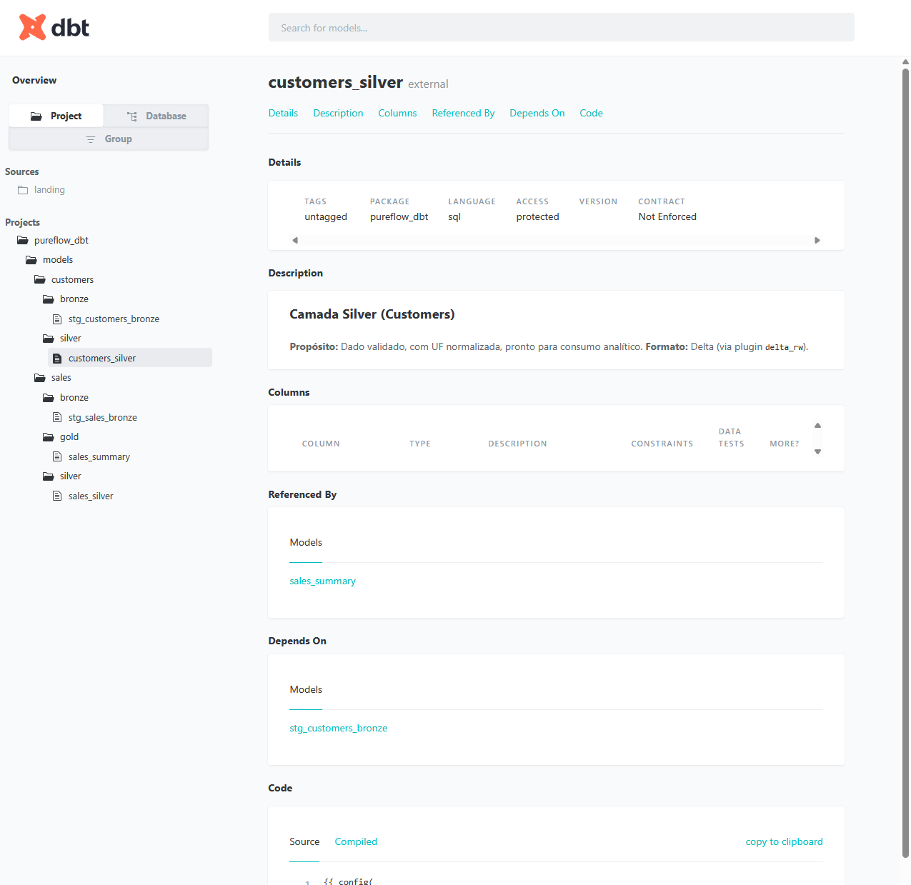
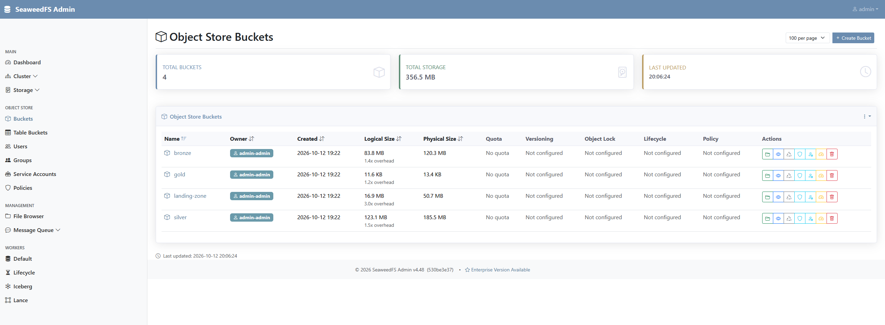
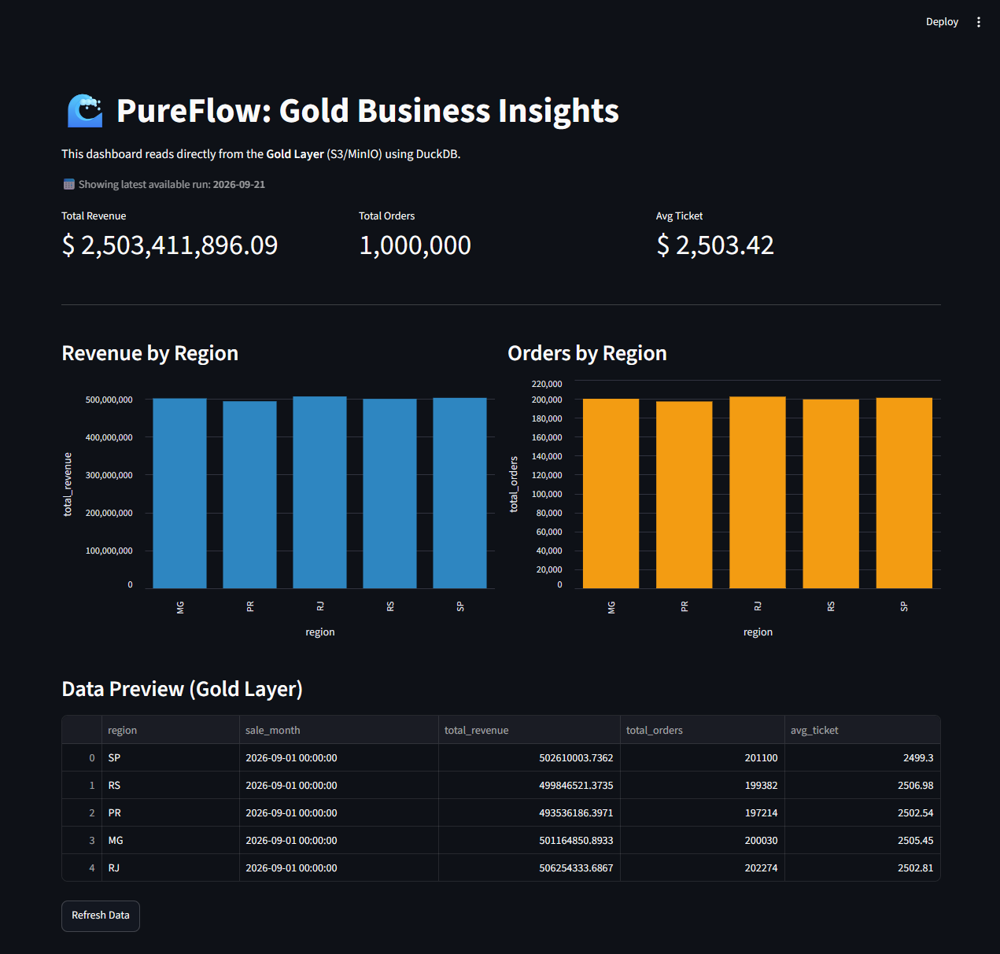

# PureFlow: Modern & Modular Data Lakehouse
### Data Engineering Capstone Project (TCC) - Medallion Architecture

**PureFlow** is a high-performance, **metadata-driven** data engineering platform. It implements a full Medallion Architecture as a real **lakehouse**: every curated layer (Bronze, Silver, Gold) is Delta Lake, not just files. The stack is 100% open-source, with dbt as the single transformation engine, integrated Data Quality (GX), and a robust DataOps CI/CD lifecycle.

---

## 🏗️ Architecture & Design Principles

The project is built on **Clean Architecture** and **SOLID** principles, ensuring that infrastructure, execution logic, and business rules are strictly decoupled.

### 1. Medallion Layers (S3-Native, Delta everywhere)
Data evolves through progressive layers in **S3 object storage (SeaweedFS)**:
*   **Landing (Raw):** Source files (CSV/JSON) in their original format. It is the only layer that isn't Delta; it's the true external boundary, read by dbt through sources that point at a small read plugin (`meta.plugin: landing_read` + `meta.path_template`, see `src/dbt_plugins/landing_source.py`).
*   **Bronze (Standardized):** Schema-enforced Delta tables, produced by dbt models.
*   **Silver (Validated & Clean):** High-quality Delta tables after **Great Expectations** gates and SQL transformations, chained via `ref()`.
*   **Gold (Business Ready):** Aggregated Delta tables managed by **dbt**, ready for BI consumption.

dbt-duckdb doesn't write Delta natively (its bundled `delta` plugin only reads), so every model routes through a small custom write plugin, `src/dbt_plugins/delta_write.py`, configured project-wide in `dbt/dbt_project.yml` (`+plugin: delta_rw`). Each model just declares its `delta_table_path`; the plugin converts dbt's staged output into a real Delta table via `delta-rs`.

### 2. Quality Gates (Great Expectations)
Every domain gets two circuit breakers around its dbt models. Both are **declared as data** in `src/core/gates.py` (`SOURCE_GATES` / `TARGET_GATES`) and built into Dagster assets and checks by `src/orchestration.py`, so a gate is one table entry rather than a hand-written block:
*   **Pre-flight (source):** a Dagster asset (e.g. `sales_landing`) validates the raw landing file *before* the Bronze dbt model reads it. It matches the corresponding dbt `source()` by name, so it is a real upstream dependency in the asset graph. Raises and quarantines on failure, blocking Bronze from ever reading bad input.
*   **Post-write (target):** a Dagster `@asset_check` per model (`check_stg_sales_bronze_target`, `check_sales_silver_target`, ...) validates the model's output right after it is written and quarantines it on failure. The Bronze and Silver checks are blocking: the next layer is not built until they pass. The Gold check is not, since nothing in the pipeline consumes Gold.

Blocking only works across ops. Dagster ignores dependencies inside a single multi-asset, so if one `dbt run` built every layer, Bronze, Silver and Gold would all be written before any check ran. `src/orchestration.py` therefore builds **one dbt op per layer** (`dbt_bronze` → checks → `dbt_silver` → checks → `dbt_gold`), and `tests/test_orchestration_wiring.py` fails if that split is undone. Blocking is per layer: a failing check on either Bronze table holds back the whole Silver layer.

Each of those dbt invocations starts on a fresh in-memory DuckDB, so a `ref()` to the previous layer would find nothing in the catalog. An `on-run-start` hook, `dbt/macros/register_upstream_delta_models.sql`, first registers every upstream model as a view over its Delta table, which means the next layer reads exactly the table its gate validated.

Quarantined data is copied, never moved, to `s3://<source-bucket>/quarantine/dt=<date>/reason=<gate>/` so the offending records stay inspectable. For a post-write gate this means the failing table is still in its layer; what the gate prevents is the *next* layer being built from it. A failure that is *technical* (storage unreachable, GX misconfigured) raises `ValidationTechnicalError` and quarantines nothing, because a gate that could not read the data has no basis to condemn it. A post-write check reports it as `failure_type: technical`; a pre-flight gate fails its step with the error.

Each breaker has its own demo job, since a single run cannot show both: corrupt landing halts the pipeline before dbt ever materializes Bronze:

| Job | What it proves |
| :--- | :--- |
| `quality_test_landing_job` | Corrupts the raw files; the pre-flight gates refuse and quarantine them before dbt runs. |
| `quality_test_bronze_job` | Step two, after a clean `pureflow_pipeline_job`: overwrites the Bronze Delta tables with bad data and re-runs only their blocking gates. dbt is excluded from it, otherwise `dbt run` would rebuild Bronze from clean landing and erase the corruption before the gate could see it. |

### 3. Adding a New Pipeline
To wire up a new domain (e.g. `products`), only dbt files are needed, with no Python registration step:
1.  **A source** for the raw landing file, in a `sources.yml` under `dbt/models/`, with `meta.plugin: landing_read` and a `meta.path_template` (see `dbt/models/landing/sources.yml`).
2.  **Bronze/Silver models**: `.sql` files under `dbt/models/products/bronze/` and `.../silver/`, following the pattern in `dbt/models/sales/`: `{{ config(delta_table_path=..., location=...) }}` at the top (bucket from `var('bronze_bucket')` etc.), `{{ source(...) }}`/`{{ ref(...) }}` in the `FROM` clause. The folder name is what matters: each layer's op selects `fqn:*.<layer>.*`.
3.  *(Optional)* Quality gates: add a `SourceGate` and/or `TargetGate` entry to `src/core/gates.py`. No Python wiring: `orchestration.py` builds the asset and the `@asset_check` from the table, and `tests/test_asset_check_wiring.py` fails the build if the entry points at a model, source or S3 path key that does not exist.

Dropping the model files in is enough for Dagster to pick them up. The per-layer dbt ops in `src/orchestration.py` (`dbt_bronze`, `dbt_silver`, `dbt_gold`) discover every model from the dbt manifest by folder, no per-domain Python wiring.

---

## 🛠️ Tech Stack & Ecosystem

*   **Orchestration:** [Dagster](https://dagster.io/) (Asset-Based, Modern Orchestrator)
*   **Storage:** [SeaweedFS](https://github.com/seaweedfs/seaweedfs) (Apache 2.0, S3-Compatible Object Storage). It replaced MinIO, whose open-source project was archived in 2026 and whose official images and binaries were taken down. Every client in the project speaks plain S3 to `storage:18900`, so the swap touched only `docker-compose.yml`, the default host name in `src/core/config.py` and the docs, not the pipeline.
*   **Processing:** [DuckDB](https://duckdb.org/) (The "SQLite for Analytics" - Local-first OLAP)
*   **Quality:** [Great Expectations](https://greatexpectations.io/) (Dynamic Data Validation)
*   **Modeling:** [dbt](https://www.getdbt.com/) (Modular SQL transformations for every medallion layer) + [delta-rs](https://github.com/delta-io/delta-rs) (Delta Lake writes via a custom dbt-duckdb plugin)
*   **DataOps:** GitHub Actions + pre-commit (Automated Linting, Security, and Testing)
*   **Code Quality:** [Ruff](https://docs.astral.sh/ruff/) (lint + format) and [Bandit](https://bandit.readthedocs.io/) (security), enforced via pre-commit hooks
*   **Environment:** Docker & [uv](https://docs.astral.sh/uv/) (Python 3.12.14)

---

## 📂 Project Structure

```text
PureFlow/
├── .github/workflows/      # CI/CD DataOps Pipelines
├── dbt/                    # dbt Project (Bronze/Silver/Gold models, all Delta;
│                           # macros/ registers the upstream layer between invocations)
├── gx/                     # Great Expectations config; HTML reports land in gx/uncommitted/
├── dagster_home/           # Dagster instance config (SQLite run storage)
├── docs/
│   ├── experiments/        # results.json from scripts/run_experiments.py + chart script
│   └── arquitetura_pt.py   # Architecture figure used in the article
├── scripts/                # doctor.sh, bucket/permission setup, run_experiments.py
├── src/
│   ├── core/               # gates.py (declarative quality gates), config/paths,
│   │                       # connection, quarantine engine, GX context
│   ├── dbt_plugins/        # dbt-duckdb plugins: Delta writes (delta-rs), landing reads
│   ├── utils/              # Synthetic data generators (clean, dirty, corruptors)
│   ├── validation/         # Generic GX Validation Wrapper
│   ├── dashboard.py        # Streamlit dashboard over the latest Gold partition
│   └── orchestration.py    # Dagster Entrypoint, per-layer dbt ops & quality gates
├── tests/                  # Unit tests for core logic, generators and gate wiring
└── pyproject.toml          # Centralized Project Metadata & Config
```

---

## 🚀 Getting Started

### 1. Prerequisites
*   Docker Desktop (or Docker Engine) with **Compose v2**. Every command here uses `docker compose`, the subcommand; the old hyphenated `docker-compose` is not shipped by current Docker Desktop.
*   [uv](https://docs.astral.sh/uv/getting-started/installation/) (optional, only needed for local development outside Docker, e.g. running tests or pre-commit hooks)

Nothing else. No Python, no compiler, no Xcode Command Line Tools: see **Portability** below for what was verified.

### 2. Configure Environment
Copy the example environment file (required: it holds the storage credentials and bucket names):
```bash
cp .env.example .env
```

### 3. Check the machine before launching
```bash
./scripts/doctor.sh
```
Verifies the Docker daemon, Compose v2, `.env`, the six published ports and free disk, and exits non-zero if anything is blocking. Worth running before a demo on a machine you have not used for this before.

### 4. Launch the Platform
```bash
docker compose up -d --build
```

> **Note (low-RAM machines):** the DuckDB resource limits (`DUCKDB_MEMORY_LIMIT`, `DUCKDB_THREADS` in `.env`) default to conservative values that fit inside Docker Desktop's default VM allocation. Raise them if you have given Docker more.

> **Note (Security):** all published ports are bound to `127.0.0.1`, so the stack is reachable only from the host machine, not from your local network, even though the default storage credentials are weak (fine for local dev, never expose these ports beyond localhost).

### 5. Monitoring & Access
| Tool | Endpoint | Description |
| :--- | :--- | :--- |
| **Dagster UI** | [http://localhost:3000](http://localhost:3000) | Pipeline Lineage & Execution |
| **Streamlit** | [http://localhost:8501](http://localhost:8501) | Business Insights Dashboard |
| **dbt Docs** | [http://localhost:8081](http://localhost:8081) | Data Documentation & Catalog |
| **GX Reports** | [http://localhost:8082](http://localhost:8082) | Data Quality HTML Reports |
| **Storage Console** | [http://localhost:18901](http://localhost:18901) | SeaweedFS admin UI: buckets and objects (log in with `STORAGE_USER` / `STORAGE_PASSWORD`) |
| **S3 API** | [http://localhost:18900](http://localhost:18900) | S3 endpoint for tools outside Docker (`S3_ENDPOINT` in `.env`) |

### 6. Run the pipeline
The stack starts with empty buckets, so generate a landing zone first. Either use the Dagster UI (Jobs → Launch) or the CLI:

```bash
docker compose exec dagster dagster job execute -f /app/src/orchestration.py -j data_generation_job
docker compose exec dagster dagster job execute -f /app/src/orchestration.py -j pureflow_pipeline_job
```

| Job | Purpose |
| :--- | :--- |
| `data_generation_job` | Writes a **clean** landing zone (1M sales, 100k customers). Run this first. |
| `dirty_data_generation_job` | Writes a **dirty** landing zone instead. Separate job on purpose: both generators write the same paths, so selecting them together would race. |
| `pureflow_pipeline_job` | The pipeline itself: pre-flight gates → dbt Bronze → Bronze gates → dbt Silver → Silver gates → dbt Gold → Gold check. |
| `baseline_no_gates_job` | The same dbt ops with every gate removed. Only used as the baseline (Scenario A) in `scripts/run_experiments.py`. |
| `quality_test_landing_job` | Demo of the pre-flight breaker (expected to fail). |
| `quality_test_bronze_job` | Demo of the post-write breaker (expected to fail). Run after a clean `pureflow_pipeline_job`. |

---

## 📂 Documentation & Visuals

The project architecture and interface previews:

### 🏗️ Architecture Diagram
*High-level overview of the Medallion flow and technology stack.*



### 🚀 Dagster UI (Orchestration)

*The `pureflow_pipeline_job` asset graph, grouped by layer: the landing pre-flight gates feed Bronze, then Silver, then Gold.*

### 🧪 Data Quality Reports (GX)

*Validation results from Great Expectations, one row per gate run, served on port 8082. Each row opens the full report for that batch.*

### 📖 dbt Documentation

*Model lineage and documentation generated by dbt.*

### 📦 Storage Console (SeaweedFS)

*SeaweedFS admin console: one bucket per medallion layer. Quarantined data lives under a `quarantine/` prefix inside the bucket it was rejected from (browse it in File Browser).*

### 📊 Streamlit Dashboard (Gold)

*Business metrics read straight from the latest Gold Delta partition with DuckDB.*

---

## 💻 Local Development (Optional)

For editing code outside Docker (IDE support, running the quality hooks before you commit):
```bash
uv sync                # installs deps into .venv, pinned via uv.lock
uv run pre-commit install   # activates the git hook (runs automatically on every commit)
uv run pytest tests/
```

---

## 🛡️ DataOps & Quality Control

Two different gates, easy to confuse:

**Code gate (before a change is merged).** Runs locally as a **pre-commit** hook on every commit (`uv run pre-commit run --all-files` to run it on demand) and again in GitHub Actions on every push and pull request, with the same hooks, so what passes locally is what passes in CI.
1.  **Linting & Formatting:** `ruff` (lint + format) and `sqlfluff` (dbt SQL).
2.  **Security:** `bandit` scans `src/`.
3.  **Testing:** `pytest` runs in CI only (`uv run pytest tests/` locally). It covers the generators, the quarantine path logic, partition-date resolution, the gate wiring and the per-layer dbt split.
4.  **Dockerfile:** `hadolint`, in CI.

**Data gate (while the pipeline runs).** Every landing source and every dbt model is validated by **Great Expectations**, as described in *Quality Gates* above. Each check attaches the GX report URL, a `failure_type` (`none` / `data_quality` / `technical`) and, on a data-quality failure, the quarantine path, so the report link survives on the failed check itself.

---

## 📌 Pinned Versions

Everything external is pinned, so a rebuild months from now produces the same stack:

| What | Where | Pinned to |
| :--- | :--- | :--- |
| Python | `.python-version`, `mise.toml`, `dockerfile` | 3.12.14 (`python:3.12.14-slim-trixie`, by digest) |
| Python packages | `pyproject.toml` (direct, `==`) + `uv.lock` (full tree) | exact versions, `uv sync --frozen` in the image and CI |
| uv | `dockerfile`, CI | 0.12.15 (`ghcr.io/astral-sh/uv`, by digest) |
| Container images | `docker-compose.yml` | tag + digest: `chrislusf/seaweedfs:4.48`, `amazon/aws-cli:2.37.13` |
| GitHub Actions | `.github/workflows/dataops.yml` | commit SHA, tag in a comment |
| pre-commit hooks | `.pre-commit-config.yaml` | commit SHA; the local hooks run the versions in `uv.lock` |

All of them come from the project's own publisher: Docker Official Images (`python`), Astral (`uv`), the SeaweedFS author (`chrislusf/seaweedfs`), AWS (`amazon/aws-cli`), and GitHub, Astral and Hadolint for the actions. The `apt-get` packages in the `dockerfile` (`curl`, `git`, build tools) are the one exception: Debian removes superseded versions from its mirrors, so pinning them would break the build instead of protecting it. The base image digest still fixes the Debian release they come from.

---

## 💻 Portability

The stack runs natively on x86_64 and arm64, Linux, macOS (Intel and Apple Silicon) and Windows via WSL2. Two things were checked rather than assumed:

*   **Every image is multi-arch.** `python:3.12.14-slim-trixie`, `chrislusf/seaweedfs`, `amazon/aws-cli` and `ghcr.io/astral-sh/uv` all publish `linux/arm64`, so an Apple Silicon machine builds and runs natively with no QEMU emulation. No `platform:` is pinned anywhere in `docker-compose.yml`, which is what would force emulation.
*   **Every dependency ships a prebuilt wheel** for Linux x86_64, Linux arm64 and macOS arm64 (checked against `uv.lock`). The only packages without Linux wheels, `psutil` and `pywin32`, are declared for Windows only and never installed elsewhere.

The one host-specific script is `scripts/setup_perms.sh`, which fixes bind-mount ownership on Linux and WSL. Docker Desktop on macOS and Windows maps permissions differently, so that script is not needed there and says so.

---

## 🔬 Experiments

The numbers in the article come from `scripts/run_experiments.py`, which runs inside the Dagster container with the stack up:

```bash
docker compose exec dagster python /app/scripts/run_experiments.py
```

It compares `baseline_no_gates_job` (A) with `pureflow_pipeline_job` (B) on a clean dataset (timing, 5 interleaved runs after a warm-up) and on four defective ones (detection and propagation, counted straight from the Delta tables). Results go to `docs/experiments/results.json`; `docs/experiments/grafico_tempo.py` draws the timing chart from it. Every partition the script writes is deleted at the end.

---

## 📏 Scope & Known Limitations

Design boundaries accepted on purpose. These are not bugs, but they are worth stating explicitly for the capstone defense:
*   **Single-node processing:** DuckDB is an embedded, single-machine OLAP engine (not distributed). Fine for the dataset sizes this project targets; a production-scale lakehouse would need Spark/Trino-class distributed processing.
*   **Dagster metadata storage:** run/event history is stored in local SQLite (`dagster_home/dagster.yaml`), which is appropriate for a single dev/demo instance but not for multi-user or HA deployments (Dagster supports Postgres for that).
*   **Partition date is resolved per step, not per run:** every asset resolves `dt=` independently from `core.config.today()` (UTC by default, see `PIPELINE_TIMEZONE`). A run that crosses midnight can therefore materialize one partition and validate another. Pin `execution_date_resource.date` in the run config for a backfill or a demo started near midnight.
*   **Batch-level, layer-level gates:** one bad record fails the whole file or table, and a failing check on either Bronze table holds back the whole Silver layer. Per-record quarantine would let the valid part through, at the cost of more complexity.
*   **GX validation loads data into Pandas:** `validate_data()` (`src/validation/gx_validator.py`) pulls the full batch into memory via DuckDB → Pandas before validating. Works well at this project's scale (~1M rows with the default 4GB DuckDB memory limit); a larger dataset would need GX's SQL-native execution engine instead of the Pandas one.

---
*Developed as a Modular Data Platform for Senior Engineering Capstone.*
